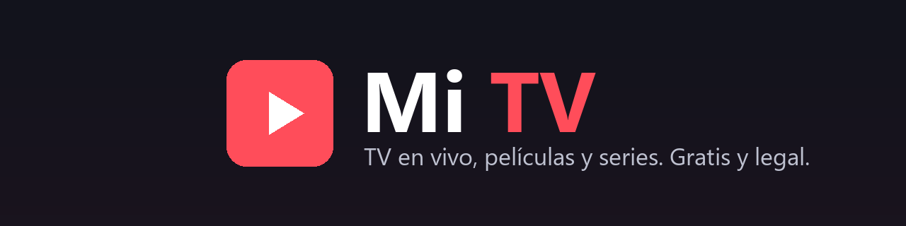
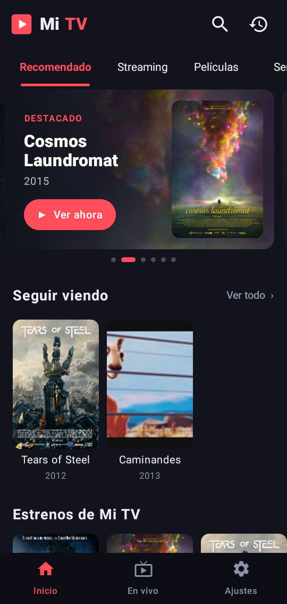
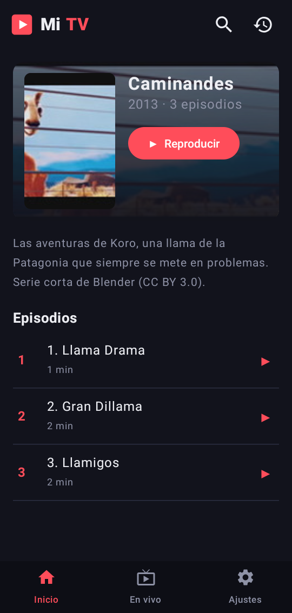
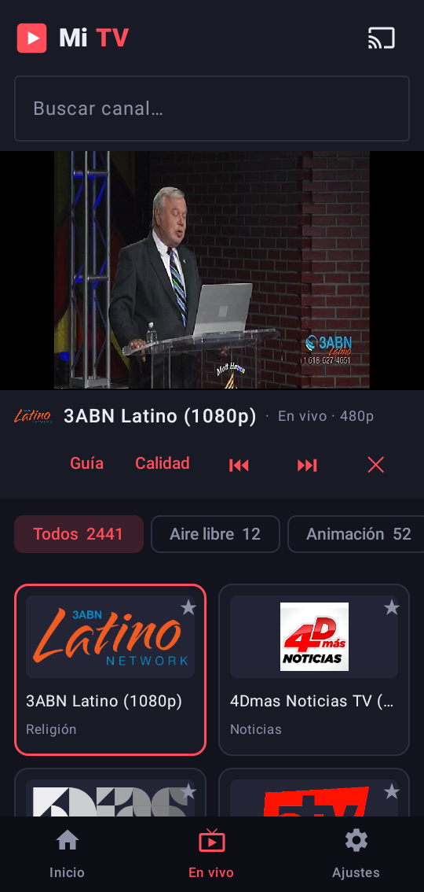
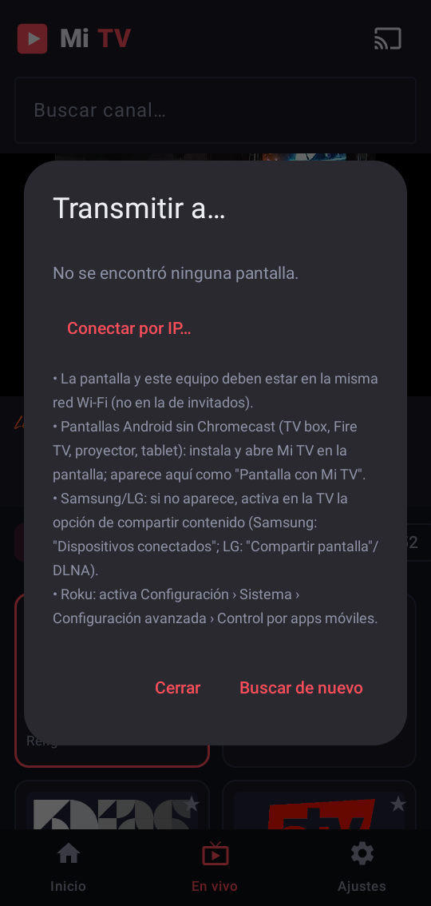
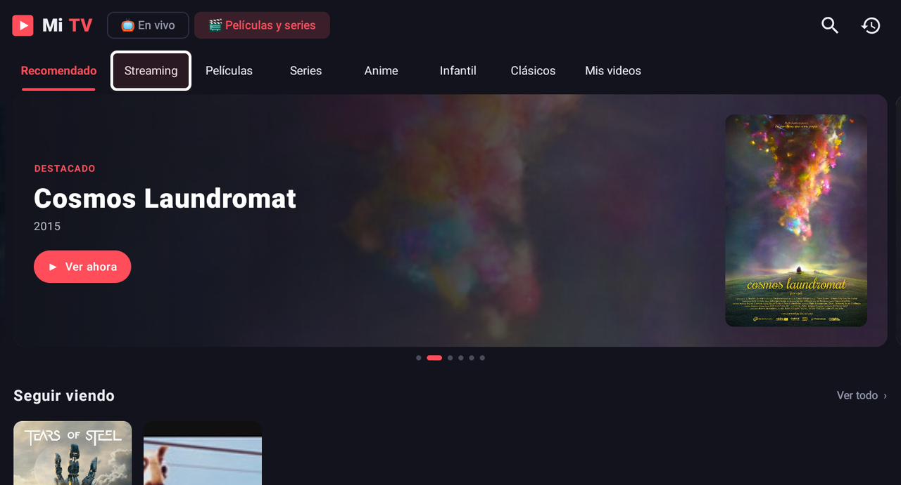

<p align="center">
  
</p>

<p align="center">
  <a href="https://github.com/alessio034/mitv-releases/releases/latest"></a>
  
  
  
</p>

<h3 align="center">
  <a href="https://github.com/alessio034/mitv-releases/releases/latest/download/mitv.apk">⬇️ Descargar Mi TV (APK)</a>
</h3>
<p align="center"><sub>Enlace fijo: siempre baja la última versión · <a href="https://github.com/alessio034/mitv-releases/releases">ver todas las versiones</a> · 🌐 <a href="https://alessio034.github.io/mitv-releases/">página web</a></sub></p>

**Mi TV** es una app para Android, Android TV y Fire TV que junta en un solo lugar miles de canales en vivo
gratuitos, películas y series de dominio público, y una guía para saber **dónde ver** cualquier película,
serie o anime en los servicios que ya pagas.

Sin cuentas, sin suscripciones y solo con contenido legal.

---

## Capturas

<p align="center">
  
  
  
  
</p>

<p align="center">
  
  <br><sub>En Fire TV y Android TV se maneja con el control remoto.</sub>
</p>

---

## Qué tiene

### 📺 TV en vivo
- **Miles de canales gratis** de todo el mundo: listas por país (México, Argentina, Colombia, Chile, Perú,
  Venezuela, España, EE. UU., Brasil…), "Todo en español", noticias, música e infantiles.
- **Pluto TV** (México, España y EE. UU.): canales de anime, películas, series, novelas y más.
- Categorías en español, buscador y **favoritos** ★.
- **Guía de programación**: qué están dando ahora y qué sigue (en los canales que la tienen).
- **Calidad del video** a elección y límite automático cuando usas datos móviles.
- ¿Tienes tu propia lista M3U? Se carga en **Ajustes → Mi lista M3U**.

### 🎬 Películas y series
- Clásicos de **dominio público** de Internet Archive: cine mudo, cine negro, westerns, terror, ciencia
  ficción, caricaturas y series de TV clásicas.
- **Estrenos de Mi TV**: películas y series libres seleccionadas (por ejemplo las de Blender:
  *Sintel*, *Cosmos Laundromat*, *Tears of Steel*, *Caminandes*).
- **Seguir viendo**: continúa donde lo dejaste, y pasa solo al siguiente episodio.
- **Mis videos**: tu servidor **Jellyfin** y los videos guardados en el equipo.

### 🔎 Streaming: dónde verlo
- Busca **cualquier película, serie o anime** y te dice en qué servicio está **en tu país**
  (Crunchyroll, Netflix, Disney+, Prime Video, Max, ViX, Pluto TV, Tubi…).
- Marca **Mis servicios** y lo que ya pagas sale primero, como *"Incluido en tu suscripción"*,
  con filas propias como **"Anime en Crunchyroll"**.
- **Abrir** te lleva directo a ese título dentro de la app del servicio.

### 📡 Transmitir a la TV
- **Chromecast / Google TV**, Smart TVs **Samsung y LG** (DLNA) y **Roku**.
- **Cualquier pantalla Android** (TV box, Fire TV, proyector, tablet): abre Mi TV en la pantalla y aparece en
  el celular como *"Pantalla con Mi TV"*. Si no aparece sola, se conecta **por IP**.
- La TV descarga el canal directamente: el celular puede apagar la pantalla.

### ✨ Además
- Diseño oscuro, pensado para celular, tablet y TV.
- **Se actualiza sola**: al abrirla te avisa cuando hay una versión nueva.
- Sin registro, sin anuncios propios y sin recolectar tus datos.

---

## Cómo instalarla

### En el celular o la tablet
1. Desde el celular, abre este enlace: [**descargar Mi TV**](https://github.com/alessio034/mitv-releases/releases/latest/download/mitv.apk).
2. Ábrelo. Si Android pregunta, permite **"Instalar apps desconocidas"** para tu navegador.
3. Toca **Instalar** y listo.

> Las siguientes versiones se instalan desde la misma app: cuando haya una nueva, verás el aviso al abrirla.

### En Fire TV / Fire Stick
1. En la tienda de Amazon instala la app **Downloader**.
2. En el Fire TV ve a **Configuración → Mi Fire TV → Opciones para desarrolladores →
   Instalar apps desconocidas** y activa **Downloader**.
3. Abre Downloader, escribe esta dirección y pulsa **Descargar Mi TV** en la página:

   ```
   alessio034.github.io/mitv-releases
   ```
   O directo al APK (siempre baja la última versión):
   `https://github.com/alessio034/mitv-releases/releases/latest/download/mitv.apk`
4. Instala. Mi TV se abre en modo TV: se maneja con las flechas y OK del control.

### En Android TV / Google TV / TV box
Igual que en Fire TV (con Downloader o desde una memoria USB), o instálala en el celular y usa
**Transmitir** para mandar los canales a la TV.

---

## Preguntas frecuentes

<details>
<summary><b>¿Es legal?</b></summary>

Sí. Mi TV solo muestra contenido que se puede ver gratis legalmente:
canales en abierto de las listas públicas de <a href="https://github.com/iptv-org/iptv">iptv-org</a>,
los canales gratuitos de Pluto TV (con sus anuncios), películas y series de <b>dominio público</b> o con
licencia <b>Creative Commons</b>, y tus propios videos. Lo que es de pago (Crunchyroll, Netflix…) se ve en la
app oficial de cada servicio: Mi TV solo te dice dónde está y te lleva ahí.
</details>

<details>
<summary><b>¿Por qué no puedo ver Crunchyroll o Netflix dentro de Mi TV?</b></summary>

Sus videos están protegidos y solo se pueden reproducir en sus apps oficiales, aunque tengas la suscripción.
Mi TV te muestra el título y con <b>Abrir</b> te lleva directo a él en la app del servicio.
</details>

<details>
<summary><b>Un canal no carga</b></summary>

Los canales gratuitos a veces cambian o dejan de transmitir. Prueba otro canal o cambia la lista en
<b>Ajustes</b>. Las listas se actualizan solas.
</details>

<details>
<summary><b>No aparece mi TV al transmitir</b></summary>

<ul>
<li>El celular y la TV deben estar en la <b>misma red Wi-Fi</b> (no en la de invitados).</li>
<li>Pantalla Android sin Chromecast (TV box, Fire TV, proyector): abre <b>Mi TV en la pantalla</b>. Si no aparece
sola, en la pantalla ve a <b>Ajustes → Recibir transmisiones</b>, mira su IP y en el celular usa
<b>Conectar por IP…</b></li>
<li>Samsung: activa "Dispositivos conectados". LG: "Compartir pantalla" / DLNA.</li>
<li>Roku: Configuración → Sistema → Configuración avanzada → <b>Control por apps móviles</b>.</li>
</ul>
</details>

<details>
<summary><b>¿Qué datos usa la app?</b></summary>

Mi TV no tiene cuentas ni guarda tus datos en ningún servidor propio. Tus favoritos, "Seguir viendo" y
ajustes quedan solo en tu equipo. La app consulta GitHub (actualizaciones y catálogo), las listas de canales,
Internet Archive, TMDB y Wikidata para mostrar la información.
</details>

---

## Créditos

- Canales: [iptv-org](https://github.com/iptv-org/iptv) y [Pluto TV](https://pluto.tv).
- Guía de programación: [iptv-epg.org](https://iptv-epg.org).
- Películas y series libres: [Internet Archive](https://archive.org) y las películas abiertas de la
  [Blender Foundation](https://studio.blender.org/films/) (CC BY). Pósters de
  [Wikimedia Commons](https://commons.wikimedia.org).
- Información de películas y "dónde verlo": [TMDB](https://www.themoviedb.org) y JustWatch.
  *Mi TV usa la API de TMDB pero no está avalada ni certificada por TMDB.*
- Enlaces directos a los títulos: [Wikidata](https://www.wikidata.org).

Los canales y marcas que aparecen pertenecen a sus dueños. Mi TV no aloja ningún video.
